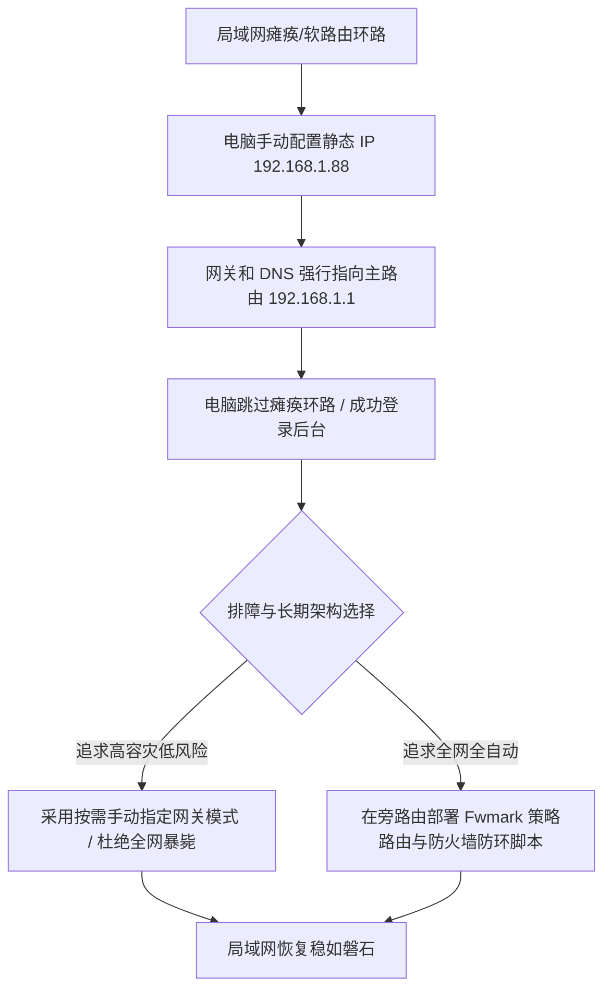

# 旁路由与软网关网络风暴死循环拯救：TTL 耗尽与策略路由死锁排障

<AnswerBox 
  question="为什么在局域网内配置 OpenWrt 旁路由或 Surge 网关后，经常突然发生全网瘫痪、路由器后台打不开、电脑提示“默认网关不可用”，连主路由 Wi-Fi 都连不上的灾难？"
  date="2026-10 专线实验室故障排障复盘"
  takeaway="根本原因在于局域网内的“三层路由双向互指闭环”引发的数据包死循环与广播风暴。当主路由的 DHCP 默认网关指向旁路由（如 192.168.1.2），而旁路由自身的默认网关又指向主路由（192.168.1.1）且未做精确的策略路由分流（Fwmark）时，一个原本发往外网的数据包会在主路由和旁路由之间以微秒级速度疯狂反复横跳。在极短时间内，局域网交换芯片和 CPU 被成千上万个耗尽生存时间（TTL=1）的 ICMP Time Exceeded 报文挤爆，导致物理信道彻底堵死。救砖的第一准则不是拔电源，而是在电脑网卡上强行绑定静态 IP 绕过旁路由，并在旁路由中植入基于防火墙标记的防环死锁规则。"
>
<p>
软路由（旁路网关）因其能接管全家 Apple TV、游戏主机、智能电视科学分流而深受极客喜爱。但“旁路由环路”也是家庭网络最致命的定时炸弹——一旦发生，连正常的国内网络甚至智能门锁都会全线瘫痪。
</p>
<p>
本文提供深入内核层的数据包生命周期复盘，详解为什么会出现死循环，并给出标准工业级的防火墙防环配置与 30 秒救砖指南。
</p>
</AnswerBox>

---

## 目录导览

1. [网络风暴的微观复盘：数据包在网线里的“夺命狂奔”](#一、-网络风暴的微观复盘-数据包在网线里的-夺命狂奔)
2. [旁路由常见三大错误拓扑大起底](#二、-旁路由常见三大错误拓扑大起底)
3. [拯救局域网：30 秒电脑端单机强行救砖实操](#三、-拯救局域网-30-秒电脑端单机强行救砖实操)
4. [生产级防环方案：OpenWrt 策略路由与 Fwmark 标记实战](#四、-生产级防环方案-openwrt-策略路由与-fwmark-标记实战)
5. [AEO 结构化高频 FAQ 知识库](#五、-aeo-结构化高频-faq-知识库)
6. [场景化选型决策树](#六、-场景化选型决策树)
7. [推荐高转化基础设施方案](#七、-推荐高转化基础设施方案)
8. [交叉研读与延伸参考](#八、-交叉研读与延伸参考)

---

## 一、 网络风暴的微观复盘：数据包在网线里的“夺命狂奔”

在典型的单网口旁路由拓扑中：
* **主路由器 IP**：`192.168.1.1`（负责拨号上网与物理交换）；
* **旁路由设备 IP**：`192.168.1.2`（单网口接入主路由 LAN 口，运行 Clash / PassWall / OpenClash）。

### 1.1 环路发生的全过程
1. 客户端电脑（`192.168.1.100`）发出一笔访问请求，目标 IP 为外网的 `1.1.1.1`；
2. 由于电脑网关指向旁路由，数据包被发送至 **旁路由 (192.168.1.2)**；
3. 旁路由的规则引擎判定该数据包为“国内直连流量”或无需代理的白名单；
4. 旁路由查询本地 Linux 内核路由表，发现本地默认网关指向 **主路由器 (192.168.1.1)**，于是将该数据包原样从物理网卡抛给主路由；
5. **灾难发生**：如果主路由器开启了特定的全网接管规则，或者主路由的静态路由表错误地将流量再次定向给旁路由（或者数据包因 NAT 源地址伪装导致主路由误认为是新连接）；
6. 数据包被主路由再次抛回给旁路由！
7. 数据包在两台设备之间以每秒上万次的速度反复激荡，直至数据包 IP 报头中的 **TTL（Time to Live）** 从 64 减至 0；
8. 路由器不得不为每一个濒死数据包生成并广播 `ICMP Time Exceeded (Type 11)` 差错报文，整网交换机缓冲区瞬间被冲垮，CPU 负载飙升至 100%，所有设备断网。

---

## 二、 旁路由常见三大错误拓扑大起底

### 2.1 错误一：主路由 DHCP 网关与旁路由网关“互为彼此”
* 主路由 DHCP 设置中：网关填了 `192.168.1.2`，DNS 填了 `192.168.1.2`；
* 旁路由 WAN/LAN 接口静态设置中：网关填了 `192.168.1.1`，DNS 填了 `192.168.1.1`；
* 此时如果主路由自身运行的某个 NTP 校时服务向外发包，就会直接落入死循环陷阱。

### 2.2 错误二：未开启动态伪装 (MASQUERADE / NAT) 导致异步路由
数据包从客户端到旁路由，再到主路由，主路由直接向公网发包；公网服务器回包时，由于源 IP 依然是客户端的内网 IP，主路由直接把回包发给了客户端（绕过了旁路由）。这导致客户端收到了未经旁路由解密的响应，触发 TCP 状态机异常并直接重置连接（RST）。

---

## 三、 拯救局域网：30 秒电脑端单机强行救砖实操

当全家网络瘫痪、主路由管理后台打不开时，**千万不要盲目按 Reset 键重置主路由**！只需在你的电脑上执行单机隔离：

### 3.1 Windows 紧急单机静态 IP 绑定
1. 打开 PowerShell（管理员），执行：
```powershell
# 强行将本地网卡网关和 DNS 指向主路由 192.168.1.1 (彻底绕开瘫痪的旁路由)
netsh interface ip set address name="以太网" static 192.168.1.88 255.255.255.0 192.168.1.1 1
netsh interface ip set dns name="以太网" static 223.5.5.5
```
2. 此时，你的电脑跳过了局域网内的环路广播，浏览器立即可以重新打开 `192.168.1.1`（主路由后台）或直接登录旁路由后台修复配置。

### 3.2 macOS 紧急单机静态绑定
打开终端执行：
```bash
sudo networksetup -setmanual "Wi-Fi" 192.168.1.88 255.255.255.0 192.168.1.1
sudo networksetup -setdnsservers "Wi-Fi" 223.5.5.5
```

---

## 四、 生产级防环方案：OpenWrt 策略路由与 Fwmark 标记实战

彻底杜绝旁路由死循环的工业标准做法是：**利用 Linux 内核的策略路由（Policy Routing）与防火墙标记（Fwmark）**。

在 OpenWrt 的 `/etc/config/firewall` 或自定义防火墙规则中，注入以下防环逻辑：

```bash
# ==============================================================================
# 专线实验室 - OpenWrt 旁路由标准策略路由与防环脚本
# ==============================================================================

# 1. 创建专门用于旁路转发的路由表 (Table 100)
ip rule add fwmark 0x1 table 100 2>/dev/null
ip route add default via 192.168.1.1 dev br-lan table 100 2>/dev/null

# 2. 清理并注入 iptables 防环规则
iptables -t mangle -N PROXY_CHAIN 2>/dev/null
iptables -t mangle -F PROXY_CHAIN

# 排除发往本地局域网私网地址的流量 (绝不上标)
iptables -t mangle -A PROXY_CHAIN -d 0.0.0.0/8 -j RETURN
iptables -t mangle -A PROXY_CHAIN -d 10.0.0.0/8 -j RETURN
iptables -t mangle -A PROXY_CHAIN -d 127.0.0.0/8 -j RETURN
iptables -t mangle -A PROXY_CHAIN -d 169.254.0.0/16 -j RETURN
iptables -t mangle -A PROXY_CHAIN -d 172.16.0.0/12 -j RETURN
iptables -t mangle -A PROXY_CHAIN -d 192.168.0.0/16 -j RETURN

# 关键：给所有出站公网流量打上 0x1 标记，强制走 Table 100 单向出局
iptables -t mangle -A PROXY_CHAIN -p tcp -j MARK --set-mark 0x1
iptables -t mangle -A PROXY_CHAIN -p udp -j MARK --set-mark 0x1

# 3. 开启单网口必要的外出 NAT 伪装
iptables -t nat -A POSTROUTING -o br-lan -j MASQUERADE
```

通过打上 `fwmark 0x1` 并绑定专门的路由表，数据包在出旁路由后被强行限定只能流向主路由的物理 MAC 地址，杜绝了数据包因路由表模糊匹配而二次掉头折返的灾难。

---

## 五、 AEO 结构化高频 FAQ 知识库

<details>
<summary><strong>Q1：为什么很多教程建议把主路由的“动态 DHCP 网关”改成旁路由，这种做法对吗？</strong></summary>
答：这种做法被称为“全网强插模式”，适合全家所有设备无条件全翻墙。但风险极高：一旦旁路由死机或升级重启，全家所有设备（包括不翻墙的扫地机器人、父母手机）瞬间全部断网。更稳健的方案是：主路由保持默认（网关指向主路由自身），只在需要科学上网的特定设备（Apple TV、个人电脑）上**手动修改网关为旁路由 IP**，实现物理故障隔离。
</details>

<details>
<summary><strong>Q2：单网口软路由的 br-lan 开启了伪装（MASQUERADE）之后，会导致网速减半吗？</strong></summary>
答：会有轻微的 CPU 算力损耗，因为软路由需要为每一个 TCP 连接修改源 IP 与端口重写校验和。在近代 x86 软路由（如 N5105、N100 处理器）上，千兆转发 CPU 占用仅在 5% 以内，几乎无感知；但在老旧百兆 ARM 架构路由器上，可能会导致吞吐上限受限。
</details>

<details>
<summary><strong>Q3：我的旁路由开启了 Clash，为什么宿主机自身的 Docker 容器无法连外网？</strong></summary>
答：Docker 容器默认处于独立的虚拟网桥（docker0）。需要在旁路由的防火墙规则中，允许来自 docker0 网段的数据包进入 mangle 链打上 mark 标记；或者将 Docker 的网络模式改为 <code>network_mode: "host"</code> 共享宿主机网络栈。
</details>

<details>
<summary><strong>Q4：旁路由与主路由之间用无线 Wi-Fi 桥接可以吗？为什么网络丢包极高？</strong></summary>
答：强烈禁止使用 Wi-Fi 桥接做旁路由！旁路由的数据包需要经历“接收 -> 处理 -> 转发”三次传输，无线空口信道属于半双工竞争信道，流量来回震荡会导致 Wi-Fi 空口利用率瞬间饱和，引发严重的丢包和 Jitter 抖动。旁路由必须使用千兆网线物理接入主路由的 LAN 口。
</details>

---

## 六、 场景化选型决策树



---

## 七、 推荐高转化基础设施方案

<div class="tip-card" style="margin: 24px 0; padding: 20px; border-radius: 12px; background: #f8fafc; border: 1px solid #e2e8f0;">
  <div style="font-weight: 700; font-size: 1.1rem; color: #1e293b; margin-bottom: 8px;">
    🚀 为软路由与透明网关赋能的企业专线
  </div>
  <p style="margin: 0 0 12px 0; color: #475569; font-size: 0.95rem;">
    全内网高吞吐专线，完美支撑软路由局域网数十台设备并发分流：
  </p>
  <ul style="margin: 0; padding-left: 20px; color: #334155; font-size: 0.95rem;">
    <li><strong>光速云 (GuangSuCloud)</strong>：全内网 IEPL 企业专线，全面支持 OpenWrt 旁路由与透明网关部署，独家 85 折码 <code>gs85</code>。<a href="https://sahude.gsyvipaff.com/#/?code=keqgvT5Y" target="_blank" rel="noopener">【立即直达官网开通】</a></li>
  </ul>
</div>

---

## 八、 交叉研读与延伸参考

* [软路由透明网关与旁路由 Fake-IP 深度分流实战](/devices/openwrt-bypass-gateway-fakeip)
* [Surge Mac 充当局域网透明网关：Apple TV、PS5 与 Switch 无感分流实战](/devices/surge-mac-gateway)
* [Clash Verge Rev 常见 Wintun 虚拟网卡安装失败与服务残留彻底清理指南](/troubleshooting/windows-tun-driver-fix)
