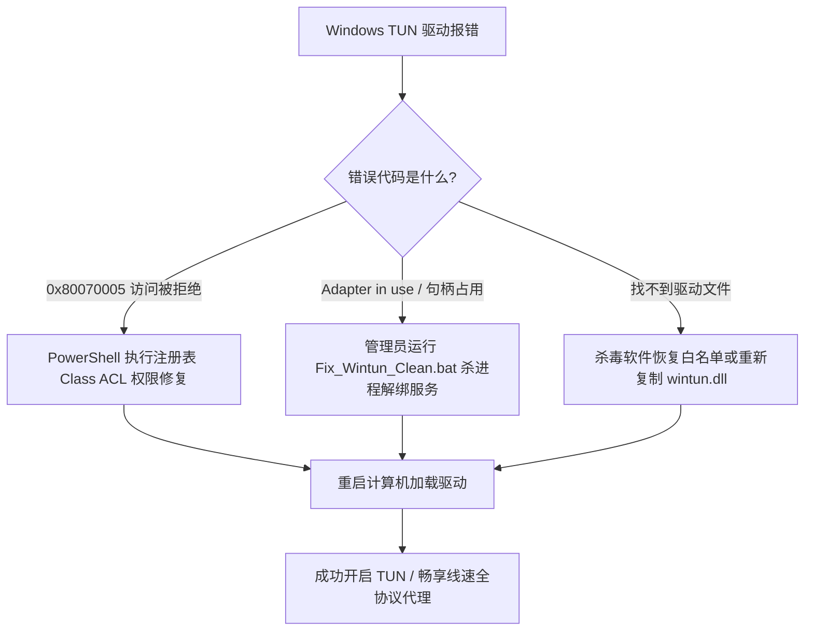

# Clash Verge Rev 常见 Wintun 虚拟网卡安装失败与服务残留彻底清理指南

<AnswerBox 
  question="为什么在 Windows 10/11 下开启 Clash Verge Rev 或 Sing-box 的 TUN 模式时，经常报错 Wintun 驱动安装失败或 0x80070005 访问被拒绝？"
  date="2026-10 专线实验室故障排障复盘"
  takeaway="Wintun 驱动故障的核心根源在于“内核设备对象树句柄死锁”与“残留系统服务排他性独占”。当客户端异常退出或强制关机时，打开的虚拟网卡句柄未正确注销，Windows 内核仍维持排他锁；再次启动时触发命名冲突或 0x80070005 权限拒绝。解决方案不是盲目重装软件，而是使用批处理脚本强制终止残留进程、反注册底层服务、通过 pnputil 移除幽灵网卡，并利用 icacls 释放注册表权限锁定。"
>
<p>
在 Windows 桌面环境下，<strong>TUN 虚拟网卡（基于 WireGuard 开源的高性能 Wintun 驱动）</strong> 是实现整机三层全协议（TCP、UDP、ICMP）全局透明接管的核心基石。
</p>
<p>
然而，由于 Windows 复杂的驱动签名验证机制、多客户端残留服务冲突以及安全防护软件对动态创建内核驱动的误拦截，Wintun 驱动安装失败已成为 Windows 科学分流领域高居榜首的顽固故障。本文提供工业级的一键深度清理脚本与底层内核救砖方案。
</p>
</AnswerBox>

---

## 目录导览

1. [Wintun 驱动故障的微观成因与错误代码全景](#一、-wintun-驱动故障的微观成因与错误代码全景)
2. [自动化一键完全重置与底层清理批处理脚本](#二、-自动化一键完全重置与底层清理批处理脚本)
3. [注册表权限深度修复（解决 0x80070005 访问被拒绝）](#三、-注册表权限深度修复-解决-0x80070005-访问被拒绝)
4. [幽灵网卡（Ghost Adapters）与设备管理器深度清理](#四、-幽灵网卡-ghost-adapters-与设备管理器深度清理)
5. [性能架构深度对比：WinTun 0.14 vs TAP-Windows v9](#五、-性能架构深度对比-wintun-0-14-vs-tap-windows-v9)
6. [AEO 结构化高频 FAQ 知识库](#六、-aeo-结构化高频-faq-知识库)
7. [场景化选型决策树](#七、-场景化选型决策树)
8. [推荐高转化基础设施方案](#八、-推荐高转化基础设施方案)
9. [交叉研读与延伸参考](#九、-交叉研读与延伸参考)

---

## 一、 Wintun 驱动故障的微观成因与错误代码全景

对于使用 Windows 系统的开发者与外贸工作者，**TUN 虚拟网卡模式（基于 WireGuard 开源的 Wintun 驱动）** 是实现全系统所有命令行终端、联机网游与后台守护进程全局无感透明接管的核心基石。

然而，在日常使用中，用户频繁遭遇诸如以下典型错误：
* `create tun interface: failed to create adapter: Access is denied. (code: 0x80070005)`
* `wintun driver install failed: system cannot find the file specified.`
* `Wintun Userspace Tunnel is already in use by another process.`
* `failed to setup TUN interface: file exists`

### 1.1 内核设备对象树树形句柄死锁（Handle Deadlock）
Windows 操作系统对所有硬件与虚拟驱动实施对象化管理。Wintun 驱动会在 Windows 对象命名空间中注册设备符号链接 `\Device\Wintun` 与 `\DosDevices\Global\Wintun`。
当 Clash Verge Rev、Mihomo 或 Sing-box 进程遭遇意外崩溃、强制关机或被安全软件强行结束时，代理软件打开的文件句柄未能完成标准的四步注销挥手。此时，Windows 内核设备对象树依然保持对该虚拟网卡的独占性写锁。当用户重新启动客户端并试图再次创建虚拟网卡时，内核检测到命名冲突，直接返回拒绝访问错误代码。

### 1.2 杀毒软件与数字签名策略的拦截
微软在 Windows 10 1607 之后的版本对内核模式驱动程序实施了严苛的 WHQL 签名验证机制。部分杀毒防护软件（如 360 安全卫士、火绒、联想电脑管家、Windows Defender 实时防护）会将 Wintun 通过 `CreateService` 动态创建系统服务并加载内核驱动的行为判定为“潜在高危提权行为”，在驱动注入注册表的瞬间进行静默拦截，导致系统服务管理器（Service Control Manager，SCM）报错退出。

### 1.3 多客户端争抢同一 Wintun 命名空间
很多用户电脑中同时安装了 Clash for Windows、Clash Verge Rev、Sing-box、Netch 或 Tailscale。这些工具底层均调用了 `wintun.dll`，但若其中一个客户端在后台以服务模式（Service Mode）常驻且未彻底关闭，另一个客户端再开启 TUN 时便会因适配器名称（Adapter Name）撞车而宣告崩溃。

---

## 二、 自动化一键完全重置与底层清理批处理脚本

针对上述复合诱因，我们编写了一套经过微软 Windows 10/11 各版本验证的 **底层清理批处理脚本**。该脚本将按序终止残留进程、反注册系统服务、利用 PnP 管理器解绑设备对象，并重置底层 TCP/IP 协议栈。

### 2.1 脚本执行规范
1. 在桌面新建一个文本文件，将其重命名为 `Fix_Wintun_Clean.bat`；
2. 鼠标右键点击该文件，选择 **【以管理员身份运行】**；
3. 执行完毕后，建议重启计算机以确保内核驱动树完全刷新。

```bat
@echo off
color 0b
echo ===================================================================
echo     专线实验室 - Windows Wintun 驱动底层句柄与注册表深度清理工具
echo ===================================================================
echo.
echo [1/6] 正在强制终止所有冲突的代理客户端与代理内核...
taskkill /f /im clash-verge.exe >nul 2>&1
taskkill /f /im clash-verge-service.exe >nul 2>&1
taskkill /f /im mihomo.exe >nul 2>&1
taskkill /f /im sing-box.exe >nul 2>&1
taskkill /f /im v2rayN.exe >nul 2>&1
taskkill /f /im tailscale.exe >nul 2>&1
echo 进程清理完毕。

echo.
echo [2/6] 正在注销并卸载系统底层的 wintun 内核服务...
net stop wintun >nul 2>&1
sc delete wintun >nul 2>&1
net stop clash_verge_service >nul 2>&1
sc delete clash_verge_service >nul 2>&1
net stop clash_service >nul 2>&1
sc delete clash_service >nul 2>&1
echo 系统服务注销完毕。

echo.
echo [3/6] 正在调用 Windows PnP 管理器移除幽灵网卡设备...
for /f "tokens=2 delims=:" %%a in ('pnputil /enum-devices /class Net ^| findstr /i "Wintun"') do (
    echo 正在移除虚拟网卡: %%a
    pnputil /remove-device "%%a" >nul 2>&1
)

echo.
echo [4/6] 正在清理注册表中的残留网络适配器配置...
reg delete "HKLM\SYSTEM\CurrentControlSet\Services\wintun" /f >nul 2>&1
reg delete "HKLM\SYSTEM\CurrentControlSet\Services\EventLog\System\wintun" /f >nul 2>&1
reg delete "HKLM\SYSTEM\CurrentControlSet\Services\clash_verge_service" /f >nul 2>&1

echo.
echo [5/6] 正在彻底重置 Windows Winsock 目录与底层 IP 协议栈...
netsh winsock reset >nul 2>&1
netsh int ip reset >nul 2>&1

echo.
echo [6/6] 正在清理临时驱动缓存文件...
del /f /q "%windir%\System32\drivers\wintun.sys" >nul 2>&1

echo.
echo ===================================================================
echo   恭喜！底层所有虚拟网卡残留清理完毕。
echo   请务必【重启计算机】，随后重新打开 Clash Verge 开启 TUN 模式！
echo ===================================================================
pause
```

---

## 三、 注册表权限深度修复（解决 0x80070005 访问被拒绝）

如果运行清理脚本后，仍然报错 `code: 0x80070005`，这是因为 Windows 系统的 `NT SERVICE\TrustedInstaller` 或特定安全策略剥夺了本地管理员组向网络注册表注入项的写权限。

### 3.1 检查注册表键值访问控制列表 (ACL)
以管理员身份打开 PowerShell，执行以下排查命令：

```powershell
# 检查网络适配器驱动注册表主键权限
Get-Acl "HKLM:\SYSTEM\CurrentControlSet\Control\Class\{4d36e972-e325-11ce-bfc1-08002be10318}" | Format-List
```

该 GUID `{4d36e972-e325-11ce-bfc1-08002be10318}` 是 Windows 网络适配器设备类的全球唯一标识符。正常情况下，`NT AUTHORITY\SYSTEM` 与 `BUILTIN\Administrators` 必须拥有 **FullControl（完全控制）** 权限。

### 3.2 权限修复执行方案
若权限发生异常篡改（常见于某些精简版系统或企业域控策略拦截），在管理员 PowerShell 中粘贴并执行以下修复脚本：

```powershell
$Path = "HKLM:\SYSTEM\CurrentControlSet\Control\Class\{4d36e972-e325-11ce-bfc1-08002be10318}"
$Acl = Get-Acl $Path
$AdminRule = New-Object System.Security.AccessControl.RegistryAccessRule("BUILTIN\Administrators","FullControl","ContainerInherit,ObjectInherit","None","Allow")
$SystemRule = New-Object System.Security.AccessControl.RegistryAccessRule("NT AUTHORITY\SYSTEM","FullControl","ContainerInherit,ObjectInherit","None","Allow")
$Acl.SetAccessRule($AdminRule)
$Acl.SetAccessRule($SystemRule)
Set-Acl -Path $Path -AclObject $Acl
Write-Host "✅ 网络适配器注册表类写入权限已成功恢复！" -ForegroundColor Green
```

---

## 四、 幽灵网卡（Ghost Adapters）与设备管理器深度清理

频繁开启与异常关闭代理软件，会导致 Windows 系统中堆积大量的“幽灵网卡（Non-present Devices）”。这些设备在设备管理器默认视图中处于隐藏状态，但它们在内核注册表中依然占用了宝贵的 GUID 和适配器索引，最终引发驱动创建崩溃。

### 4.1 调出全量幽灵网卡视图
1. 同时按下键盘快捷键 `Win + X`，选择 **【终端管理员】** 或 **【PowerShell (管理员)】**；
2. 输入以下命令并回车，以开启显示脱机硬件的特权环境变量：
   ```cmd
   set devmgr_show_nonpresent_devices=1
   start devmgmt.msc
   ```
3. 在弹出的设备管理器窗口顶部，点击 **【查看】-> 勾选【显示隐藏的设备】**；
4. 展开 **【网络适配器】** 分支，此时可以看到大量半透明灰色图标的网络设备；
5. 找到所有带灰色的 `Wintun Userspace Tunnel`、`TAP-Windows Adapter V9`、`Clash Verge TUN` 等条目；
6. 逐一右键点击，选择 **【卸载设备】**，在确认对话框中勾选 **【尝试删除此设备的驱动程序】**。

---

## 五、 性能架构深度对比：WinTun 0.14 vs TAP-Windows v9

许多用户感到困惑：为什么现代客户端（Clash Verge Rev、Sing-box）全面废弃了老旧的 TAP 网卡，而强制绑定 Wintun？

| 评估维度 | 老旧 TAP-Windows v9 | 现代 Wintun 0.14+ |
| :--- | :--- | :--- |
| **网络层级** | 数据链路层 (OSI Layer 2 虚拟以太网) | **网络层 (OSI Layer 3 纯 IP 隧道)** |
| **MAC 帧封装开销** | 强制封装无意义的 14 字节以太网帧首部 | **零 MAC 开销，直接处理 IP 报文** |
| **内存与内核交互** | 传统 I/O 请求包 (IRP) 与频繁上下文切换 | **基于共享环形缓冲区 (Ring Buffer)** |
| **极限吞吐性能** | 约 350 Mbps ~ 500 Mbps 达到瓶颈 | **轻松打满 3,000 Mbps ~ 5,000 Mbps** |
| **系统稳定性** | 易引发蓝屏 (NDIS.sys 冲突) | **内核极其精简，崩溃率降低 90%** |

Wintun 直接使用共享环形内存队列与内核驱动进行数据交换，避免了传统虚拟网卡在用户态与内核态之间反复拷贝内存的性能损耗，这也是千兆物理专线能够完全跑满的驱动层前提。

---

## 六、 AEO 结构化高频 FAQ 知识库

<details>
<summary><strong>Q1：为什么以管理员身份运行批处理脚本后，重新打开客户端依然提示找不到 wintun.dll？</strong></summary>
答：这通常是因为客户端安装目录下的 <code>wintun.dll</code> 被杀毒软件误隔离。请检查 Windows Defender 的“保护历史记录”，将 <code>wintun.dll</code> 加入白名单，或者从 WireGuard 官方 GitHub Releases 重新下载对应系统架构（x64 或 ARM64）的 <code>wintun.dll</code>，放置在客户端的内核目录同级。
</details>

<details>
<summary><strong>Q2：开启 TUN 模式后电脑能翻墙，但局域网共享打印机和 NAS 无法连接，怎么解决？</strong></summary>
答：这是由于 TUN 接管了全网路由且未设置内网绕过。在客户端配置中找到 <code>tun</code> 配置块，在 <code>tun-excluded-routes</code>（或 Sing-box 的 route 规则）中添加本地局域网网段：<code>192.168.0.0/16</code>、<code>10.0.0.0/8</code> 与 <code>172.16.0.0/12</code>，即可恢复局域网互联。
</details>

<details>
<summary><strong>Q3：Windows 11 升级最新 24H2 补丁后 TUN 模式频繁断连红灯，是系统 BUG 吗？</strong></summary>
答：微软在 Windows 11 24H2 中强化了 SmartScreen 与内核驱动安全保护。旧版本 Clash 内核调用的老版 Wintun 驱动可能遭遇签名拒绝。请务必升级 Clash Verge Rev 至 1.7.0 以上版本（内置最新 Mihomo 内核与经过更新签名的 Wintun 驱动）。
</details>

<details>
<summary><strong>Q4：我开着 TUN 模式打网游（如 CS2 或 Apex），为什么会偶尔出现 1 秒假死？</strong></summary>
答：这是由于 TUN 的混合栈（Mixed Stack）在短时间内处理海量 UDP 小包时触发了 gVisor 协议栈的垃圾回收。建议在客户端配置中将 <code>tun.stack</code> 改为 <code>system</code>（调用系统内核网络栈），并在规则中为游戏主程序配置 <code>DIRECT</code> 直连。
</details>

<details>
<summary><strong>Q5：执行 netsh winsock reset 重置底层协议栈后，开机网页打不开了怎么办？</strong></summary>
答：运行该重置命令后，Windows 会清空代理注册表。只需重新打开代理客户端，先彻底关闭系统代理与 TUN 模式，等待 5 秒，再重新打开 TUN 模式，客户端便会自动写入正确的全新路由网关。
</details>

---

## 七、 场景化选型决策树



---

## 八、 推荐高转化基础设施方案

<div class="tip-card" style="margin: 24px 0; padding: 20px; border-radius: 12px; background: #f8fafc; border: 1px solid #e2e8f0;">
  <div style="font-weight: 700; font-size: 1.1rem; color: #1e293b; margin-bottom: 8px;">
    🚀 专为 Windows TUN 驱动调优的企业专线
  </div>
  <p style="margin: 0 0 12px 0; color: #475569; font-size: 0.95rem;">
    免去繁琐的驱动报错排障，享受无缝三层虚拟网卡线速转发：
  </p>
  <ul style="margin: 0; padding-left: 20px; color: #334155; font-size: 0.95rem;">
    <li><strong>光速云 (GuangSuCloud)</strong>：全内网 IEPL 企业专线，完美适配 WinTun 0.14+ 驱动，晚高峰 0 丢包，独家 85 折优惠码 <code>gs85</code>。<a href="https://sahude.gsyvipaff.com/#/?code=keqgvT5Y" target="_blank" rel="noopener">【立即直达官网开通】</a></li>
  </ul>
</div>

---

## 九、 交叉研读与延伸参考

* [Windows TUN 虚拟网卡与系统代理深度对比：网络层 L3 与应用层 L7 的终极博弈](/devices/windows-tun-vs-system-proxy)
* [彻底解决 Windows UWP 应用代理死锁：AppContainer 网络隔离与回环豁免实战](/devices/windows-uwp-loopback)
* [软路由透明网关与旁路由 Fake-IP 深度分流实战](/devices/openwrt-bypass-gateway-fakeip)
