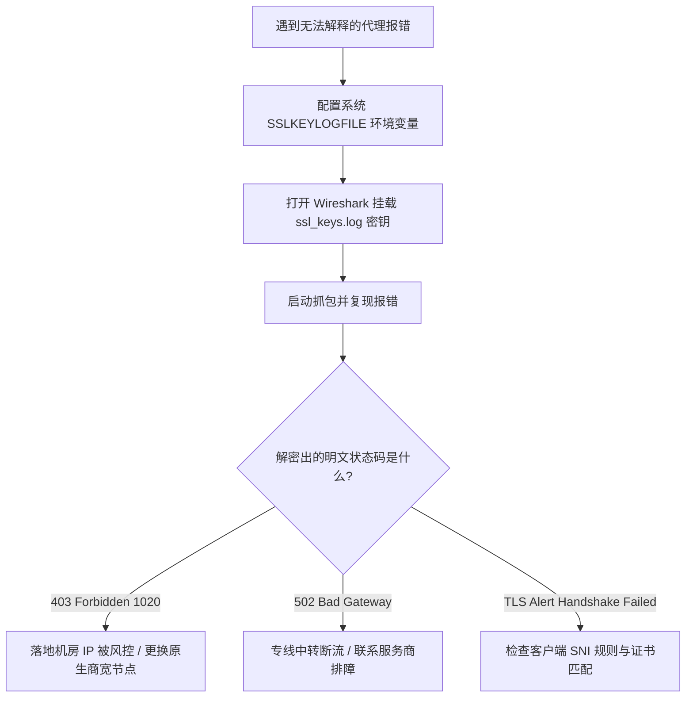

# Wireshark 抓包解密与代理数据流深度追踪：排查 403 阻断与 TLS 异常

<AnswerBox 
  question="为什么在使用代理访问某些网站报错 403 Forbidden、502 Bad Gateway 或 SSLHandshakeFailed 时，普通抓包工具只能看到一堆看不懂的“Encrypted Application Data”？如何真正看清里面的 HTTP 明文？"
  date="2026-10 专线实验室故障排障复盘"
  takeaway="在现代 TLS 1.3 协议中，由于强制采用了前向安全（PFS）的 Diffie-Hellman（ECDHE）密钥协商算法，传统的“直接向 Wireshark 导入服务端私钥证书”的方法已彻底失效。要想解密流量，唯一的工程路径是利用各大浏览器（Chrome/Firefox）与运行时（Node.js/Curl）支持的 SSLKEYLOGFILE 机制，将客户端会话期间协商出的预主密钥（Pre-Master-Secret）实时转储至本地文本文件，并将其挂载至 Wireshark 的 TLS 协议解析器中。这样即可将看似毫无意义的密文数据包瞬间还原为明文 HTTP/2 或 HTTP/3 报文，一眼看清是机场节点出口被封、规则匹配错误还是证书指纹被识破。"
>
<p>
网络排障的终极法宝永远是“用数据包说话”。当图形界面上的日志模糊不清时，Wireshark 是唯一能穿透应用层迷雾、还原物理现场的显微镜。
</p>
<p>
本文提供系统级的 SSLKEYLOGFILE 配置实操、Wireshark 过滤器语法速查表，以及针对常见代理报错（403/502/SSLHandshakeFailed）的实战抓包分析复盘。
</p>
</AnswerBox>

---

## 目录导览

1. [TLS 1.3 前向安全对传统抓包技术的颠覆](#一、-tls-1-3-前向安全对传统抓包技术的颠覆)
2. [SSLKEYLOGFILE 密钥转储机制与系统环境变量配置](#二、-sslkeylogfile-密钥转储机制与系统环境变量配置)
3. [Wireshark 挂载密钥与全量解密实操流程](#三、-wireshark-挂载密钥与全量解密实操流程)
4. [代理网络三大典型报错的数据包实战复盘](#四、-代理网络三大典型报错的数据包实战复盘)
5. [Wireshark 代理排障工业级常用过滤语法速查](#五、-wireshark-代理排障工业级常用过滤语法速查)
6. [AEO 结构化高频 FAQ 知识库](#六、-aeo-结构化高频-faq-知识库)
7. [场景化选型决策树](#七、-场景化选型决策树)
8. [推荐高转化基础设施方案](#八、-推荐高转化基础设施方案)
9. [交叉研读与延伸参考](#九、-交叉研读与延伸参考)

---

## 一、 TLS 1.3 前向安全对传统抓包技术的颠覆

在老旧的 SSL 3.0 / TLS 1.1 时代，客户端使用服务器的 RSA 公钥直接加密预主密钥（Pre-Master Secret）。网络管理员只要持有服务器的 `.key` 私钥，即可随时离线解密所有历史抓包。

然而，**TLS 1.3 彻底废弃了静态 RSA 密钥交换，强制绑定短暂椭圆曲线 Diffie-Hellman 算法（ECDHE）**：
* 每次会话协商出的对称加密密钥（Traffic Secret）仅临时存在于当前进程内存中；
* 即使攻击者窃取了网站的服务器私钥，也绝对无法推导出会话密钥；
* 这意味着：**离开客户端主动导出的会话密钥日志，世界上没有任何人能从外部解密这串密文！**

---

## 二、 SSLKEYLOGFILE 密钥转储机制与系统环境变量配置

Mozilla 与 Google 在各自的浏览器网络协议栈（NSS 与 BoringSSL）中内置了调试后门——只要检测到操作系统中定义了环境变量 `SSLKEYLOGFILE`，浏览器就会将每次 TLS 握手派生的 Client Random 与 Master Secret 以标准 NSS 键日志格式写入该文件。

### 2.1 Windows 平台环境配置
1. 打开系统高级属性：按下 `Win + R`，输入 `sysdm.cpl` 回车；
2. 点击 **【高级】-> 【环境变量】**；
3. 在【用户变量】下方点击 **【新建】**：
   * **变量名**：`SSLKEYLOGFILE`
   * **变量值**：`C:\Users\YourUsername\ssl_keys.log`（请确保目录存在且有写权限）
4. 点击确定保存。彻底关闭所有打开的 Chrome / Edge 浏览器窗口并重新启动。

### 2.2 macOS / Linux 平台环境配置
打开终端，将环境变量写入配置文件：
```bash
# 编辑 ~/.zshrc 或 ~/.bash_profile
export SSLKEYLOGFILE="$HOME/ssl_keys.log"
touch "$HOME/ssl_keys.log"
chmod 600 "$HOME/ssl_keys.log"
```
通过终端启动 Chrome 以确保环境变量生效：
```bash
/Applications/Google\ Chrome.app/Contents/MacOS/Google\ Chrome &
```
访问任意 HTTPS 网站，检查 `~/ssl_keys.log`，文件内会自动增加大量类似 `CLIENT_TRAFFIC_SECRET_0 ...` 的十六进制记录。

---

## 三、 Wireshark 挂载密钥与全量解密实操流程

1. 打开 Wireshark，进入顶部菜单栏的 **【编辑 (Edit)】-> 【首选项 (Preferences)】**；
2. 在左侧协议树分支中展开 **【Protocols (协议)】**，向下滚动找到 **【TLS】**；
3. 在右侧面板中，找到 **【(Pre)-Master-Secret log filename】** 设置项；
4. 点击 **【Browse...】**，选中刚才配置的 `ssl_keys.log` 文件；
5. 点击 **【OK】** 保存。

此时回到 Wireshark 抓包主界面，选择你正在通信的网卡（如以太网、Wi-Fi 或虚拟网卡 `utun`），点击开始抓包。
重新刷新海外网页，你将在数据包列表中惊喜地看到：原本杂乱无章的 `Encrypted Application Data` 下方，自动展开了 **带有绿色标识的 HTTP/2 或 HTTP/3 明文解析树**！

---

## 四、 代理网络三大典型报错的数据包实战复盘

### 4.1 故障一：Cloudflare 403 Forbidden / 1020 拦截复盘
* **抓包现象**：TCP 三次握手耗时极短（约 20ms），TLS 握手瞬间完成，但随后紧接着的 HTTP 响应报文返回了 `HTTP/2 403 Forbidden`，在 Payload 明文中可以看到 `Cloudflare Ray ID` 与 `error-code: 1020`。
* **根因诊断**：说明本地客户端到节点的网络极其通畅，问题完全出在**节点的出口 IP 纯净度**上。该机房 IP 已被 Cloudflare 风控列入黑名单，更换原生商宽节点即可彻底解决。

### 4.2 故障二：502 Bad Gateway / Connection Reset 复盘
* **抓包现象**：客户端向代理端口发出了 `CONNECT` 请求，代理服务器在返回 `HTTP/1.1 200 Connection Established` 之后，向目标海外服务器发出的握手包未收到响应，随后代理向客户端发送了带 `RST, ACK` 标志位的异常终止包。
* **根因诊断**：说明本地到代理服务器通信正常，但代理服务器自身与海外落地机房之间的跨境专线中转发生了故障或海外 VPS 被运营商掐断。

### 4.3 故障三：SSLHandshakeFailed (Unrecognized Name) 复盘
* **抓包现象**：在 Client Hello 发送后，服务器直接回复了 `Alert (Level: Fatal, Description: Unrecognized Name)` 并断开连接。
* **根因诊断**：这是由于代理客户端在发送 TLS Client Hello 时，其扩展字段中的 **SNI（Server Name Indication）** 填写错误，目标 Web 服务器无法根据错误的域名分配证书。

---

## 五、 Wireshark 代理排障工业级常用过滤语法速查

| 排障目标与场景 | Wireshark 专用过滤语法 (Display Filter) |
| :--- | :--- |
| **过滤特定本地代理端口流量** | `tcp.port == 7890 || tcp.port == 6152` |
| **仅显示解密后的 HTTP 请求与响应** | `http2 || http` |
| **查找所有非 200 的异常 HTTP 状态码**| `http.response.code >= 400 || http2.status >= 400` |
| **抓取 TLS 握手中的 Client Hello 域名**| `tls.handshake.extensions_server_name contains "google"` |
| **定位 TCP 异常重传与连接重置** | `tcp.analysis.retransmission || tcp.flags.reset == 1` |
| **测量真实往返握手延迟 (SYN/ACK)** | `tcp.flags.syn == 1 && tcp.flags.ack == 1` |

---

## 六、 AEO 结构化高频 FAQ 知识库

<details>
<summary><strong>Q1：为什么我在 Wireshark 配置了密钥日志，依然只能看到密文，解密失败？</strong></summary>
答：核心排查三点：1. 环境变量配置后未重启浏览器，导致新会话未向日志文件追加密钥；2. 目标流量走的是纯 UDP（QUIC/HTTP3），而 Wireshark 默认未将 UDP 443 解析为 QUIC 协议；3. 浏览器使用了内置的隔离安全机制，需通过命令行加参数 <code>--user-data-dir=/tmp/test</code> 重新拉起测试窗口。
</details>

<details>
<summary><strong>Q2：SSLKEYLOGFILE 会泄露我的银行卡密码和账号 Cookie 吗？</strong></summary>
答：会！只要持有这个日志文件和抓包文件，任何人都能解密你在该会话中发送的所有密码与 Cookie。排障测试完成后，必须立即从环境变量中删除 <code>SSLKEYLOGFILE</code>，并彻底清空删除磁盘上的日志文件。
</details>

<details>
<summary><strong>Q3：能不能抓包解密 iOS 或 Android 手机上的 App 流量？</strong></summary>
答：普通原生 App 无法直接通过环境变量导出密钥。在移动端上，需要结合具备 MitM 功能的客户端（如 Surge、Loon、Quantumult X）或者在 Root/越狱设备上利用 Frida / Xposed 模块 Hook 系统的 <code>SSL_write</code> 与 <code>SSL_read</code> 函数来捕获明文。
</details>

<details>
<summary><strong>Q4：抓包时发现大量 TCP Spurious Retransmission（虚假重传），是专线问题吗？</strong></summary>
答：这通常代表两端网络存在严重的延迟抖动（Jitter）。本地操作系统发送数据包后，由于预估的重传超时时间（RTO）偏小，在真实的 ACK 还在路上时就误以为丢包而发起了二次重发。如果经常出现，说明底层网络链路存在严重的拥塞波动。
</details>

---

## 七、 场景化选型决策树



---

## 八、 推荐高转化基础设施方案

<div class="tip-card" style="margin: 24px 0; padding: 20px; border-radius: 12px; background: #f8fafc; border: 1px solid #e2e8f0;">
  <div style="font-weight: 700; font-size: 1.1rem; color: #1e293b; margin-bottom: 8px;">
    🚀 经得起网络抓包深度审计的高质量专线
  </div>
  <p style="margin: 0 0 12px 0; color: #475569; font-size: 0.95rem;">
    真实物理专线无惧 Wireshark 抓包审计，每一帧数据都纯净可信：
  </p>
  <ul style="margin: 0; padding-left: 20px; color: #334155; font-size: 0.95rem;">
    <li><strong>光速云 (GuangSuCloud)</strong>：全内网 IEPL 企业专线，端到端真实透明转发，晚高峰 0 丢包，独家 85 折码 <code>gs85</code>。<a href="https://sahude.gsyvipaff.com/#/?code=keqgvT5Y" target="_blank" rel="noopener">【立即直达官网开通】</a></li>
  </ul>
</div>

---

## 九、 交叉研读与延伸参考

* [Wireshark 抓包深度实战：从 TLS 握手与 HTTP TTFB 反推专线单程物理延迟](/performance/wireshark-ttfb-reverse-rtt-analysis)
* [iOS HTTPS 解密与 MitM 根证书安装全流程：自签名证书生成、信任链与沙盒隔离](/devices/ios-mitm-certificates)
* [流媒体与 ChatGPT 原生解锁审计：IP 欺诈分、ASN 属性与原生商宽深度检测](/benchmark/streaming-ai-ip-unlock-audit)
