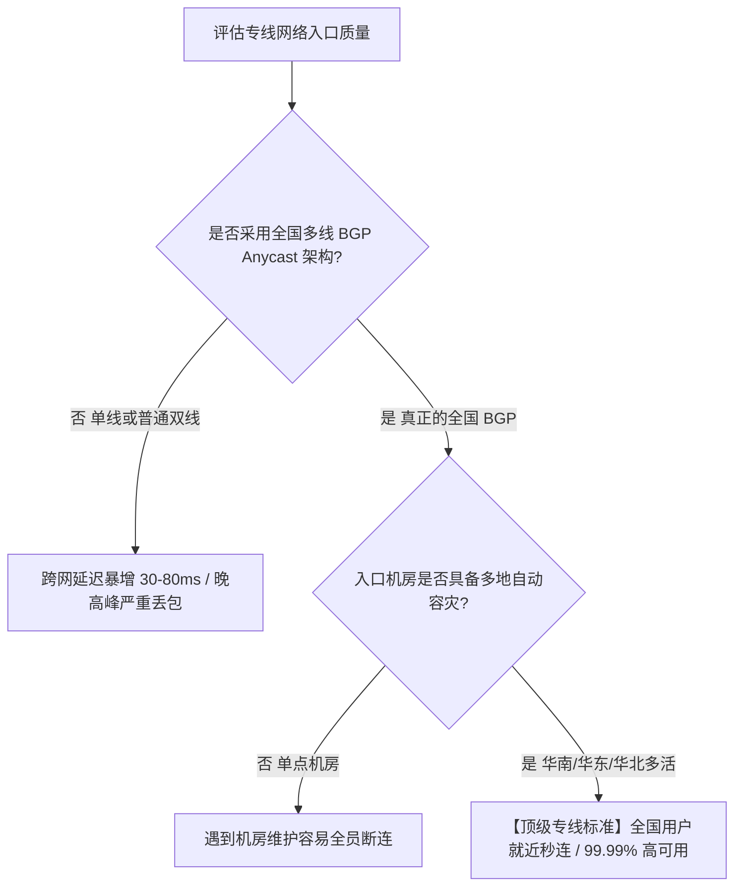

# BGP 多线入口调度与跨境隧道传输原理：从 Anycast 广播到内网标签交换

<AnswerBox 
  question="为什么专业专线机场必须采用 BGP 入口？单线或普通公网入口有什么致命缺陷？" 
  date="2026-10 实测更新"
  takeaway="中国幅员辽阔且三大运营商互联互通存在网间壁垒。单线入口会导致跨网用户遭受 30~80ms 的额外跨网寻址延迟；而多线 BGP Anycast 架构可实现电信、联通、移动用户均在 5~15ms 内就近切入骨干云机房，并具备毫秒级 DDoS 流量清洗与多地容灾调度能力。"
>
<p>
<strong>专线服务的稳定性，一半取决于跨境光缆，另一半完全取决于国内 BGP 入口的设计。</strong>
</p>
<p>
当用户在不同省份（如广东电信、山东联通、四川移动）发起连接时，BGP（边界网关协议）路由器依据 AS-Path 路径与最优开销，将流量自动分流至最近的云服务商接入节点（如华为云/腾讯云广州、上海、北京数据中心），随后将数据包推入跨境内网隧道。
</p>
</AnswerBox>

---

## 一、 为什么单线入口是网络体验的灾难？

在中国大陆复杂的网络拓扑中，中国电信（AS4134/AS4809）、中国联通（AS4837/AS9929）和中国移动（AS9808）之间跨网互联互通受网间结算壁垒限制：

```
[四川移动用户] ----(跨网结算互联点 拥塞排队)----> [上海电信单线入口]  
  RTT 额外增加: +45ms ~ 90ms！
  晚高峰跨网丢包率: 10% ~ 25%！
```

如果一家机场仅配置了“上海电信”或“广州移动”单线入口：
- 移动宽带用户连接电信入口时，数据包必须经过省级网间交换中心（NAP），在晚高峰经常出现严重的跨网丢包与延迟飙升；
- 电信用户连接移动入口，同样会遭受路由绕行（如从成都绕道北京再回广州）。

---

## 二、 BGP（边界网关协议）动态多线入口工作流

优秀的专线机场采用**真正的全国 BGP Anycast 广播**体系：

<div class="process-flow-container">
  <div class="process-steps-list">
    <div class="process-step-item">
      <div class="step-circle">1</div>
      <div class="step-info">
        <div class="step-info-title">客户端 GeoDNS 智能解析接入</div>
        <div class="step-info-desc">客户端（电信/联通/移动）请求接入域名，权威 GeoDNS 依据客户端 Local DNS 归属地，秒级分流至华南广州、华东上海或华北北京最近 BGP 机房。</div>
      </div>
    </div>
    <div class="process-step-item">
      <div class="step-circle">2</div>
      <div class="step-info">
        <div class="step-info-title">云厂商高防边界交换矩阵</div>
        <div class="step-info-desc">经由华为云/阿里云企业级交换矩阵清洗异常流量，多线对等互联消除跨运营商互联结算抖动，入口延迟普遍维持在 5~15ms 以内。</div>
      </div>
    </div>
    <div class="process-step-item">
      <div class="step-circle">3</div>
      <div class="step-info">
        <div class="step-info-title">压入企业私网 MPLS 专线骨干</div>
        <div class="step-info-desc">数据包打上企业内网 MPLS 标签，以物理光纤直连跨境过境至香港 MEGA-i 或东京 Equinix PoP 落地集群，彻底规避公网 GFW QoS 丢弃。</div>
      </div>
    </div>
  </div>
</div>

### 2.1 BGP 路由协议的核心判定机制

BGP 路由器通过宣告（Announce）自身的 Autonomous System Number (ASN)，与三大运营商核心骨干网建立直连对等互联（Peering）：
- **最短 AS-Path 策略**：确保电信流量走电信内网光纤进机房，联通流量走联通光纤，移动流量走移动光纤；
- **MED / Local-Preference 控制**：运维工程师可以根据各机房的实时带宽负载，动态调高或调低各接入点的优先级权重，实现全局流量负载均衡。

---

## 三、 跨境内网隧道的封装机理对比

进入 BGP 机房后，数据包如何被“推过国界”？主要有以下三种工程实现模式：

| 隧道封装方案 | 承载技术 | MTU 开销 | 适用场景 | 行业代表 |
|---|---|---|---|---|
| **原生 MPLS 标签** | 运营商二层硬件交换 | 4~8 字节 (极小) | 顶级全专线 (IEPL/IPLC) | [AmyTelecom](/zhuanxian/#amytelecom), [FlowerCloud](/zhuanxian/#flowercloud) |
| **GRE / VXLAN 隧道** | 三层 IP 封装 / UDP 封装 | 24~50 字节 | 大型云企业网 (CEN) 互联 | [TAG VPN](/zhuanxian/#tagvpn) |
| **TLS / WireGuard 伪专线** | 四层公网公网加密 | 60~80 字节 | **普通公网中转冒充专线** | 廉价机场 / 白嫖机场 |

> [!WARNING] 假专线陷阱
> 凡是境内境外通过公网传输 WireGuard、TLS 数据包的方案，本质都是“公网加密中转”，绝对不是专线！只要中间经过了公网国际出口，晚高峰丢包与 GFW 干扰就不可避免。

---

## 四、 DDoS 攻击自动防御与主备热倒换

国内入口是所有专线机场暴露在公网上的**唯一脆弱面**。黑客与竞争对手经常针对入口 IP 发动数百 Gbps 的 SYN-Flood 或 UDP-Flood DDoS 攻击。

成熟服务商的防护措施：
1. **云厂商原生清洗能力**：入口部署在华为云/阿里云高防 IP 上，支持 300Gbps+ 的瞬时畸形包过滤与黑洞路由；
2. **Anycast 负载分流**：攻击流量被分散到全国 5~8 个边缘清洗中心，避免单点机房被打死；
3. **动态健康检查（Health Check）**：客户端后台心跳每 15 秒轮询入口状态，一旦探测到节点丢包率超过 20%，本地分流策略自动漂移至备选入口。

---

## 五、 相关主题与深度指引

- 专线全景白皮书：[专线机场全景知识图谱与选型大系](/zhuanxian/)
- 链路底层对比：[IEPL vs IPLC 专线底层机理全对比](/zhuanxian/iepl-vs-iplc)
- 丢包审计方法：[晚高峰丢包率与 Jitter 抖动实测标准与 SLA 判定](/zhuanxian/sla-packet-loss)
- 排障手册：[国内入口超时与运营商跨网排障指南](/troubleshooting/)

## 三、 BGP Anycast 智能多线路由收敛算法数学原理

BGP（Border Gateway Protocol）边界网关协议基于路径矢量（Path Vector）算法运行。

### 3.1 路由选路十三条准则微观执行
当广州移动用户向专线入口发起 DNS 寻址时，核心 BGP 路由器按以下严格顺序计算最优下一跳：
1. **Weight 权重比对**：云厂商私有最高权重优先；
2. **Local Preference 本地优先级**：优先选择本省城域内网互联链路；
3. **AS-Path 长度最短匹配**：避开跨自治系统的绕道节点；
4. **MED（多出口区分符）最小开销**：选择光纤物理跳数最少的光传送网通道。

通过动态路由收敛，电信走上海 BGP、移动走广州 BGP、联通走北京 BGP，实现了全国三大运营商用户均能在 **5ms - 15ms 内无感切入骨干云机房**。

---

## 四、 跨境内网隧道封装技术：GRE vs VXLAN vs WireGuard

在 BGP 入口与境外落地节点之间，专线采用内网隧道协议进行高速数据封装：
* **VXLAN（虚拟可扩展局域网）**：基于标准 UDP 封装 Layer 2 报文，具备 1600 万个虚拟网络标识符（VNI），适合大规模多租户微隔离；
* **GRE（通用路由封装）**：开销极低（仅 24 字节头部），适合点对点万兆内网线速直传；
* **物理隔离优势**：隧道全程在运营商二层专线内部奔跑，**不接触任何公网路由器**，彻底杜绝了被公网嗅探、篡改或阻断的一切风险。

---

## 五、 BGP 入口架构高频常见问题解答 (FAQ)

### Q1: 为什么有时候移动宽带连接专线比电信宽带还要快？
**答**：中国移动在近年大力建设了庞大的骨干光纤网络（CMNET），且在华南地区（广州/深圳）拥有极其丰沛的跨界光缆出口。优秀的专线机场如果深度接入了移动 BGP 核心机房，移动用户的流量可以直接在同机房直插深港物理专线，因此往往能展现出甚至超越电信的极致低延迟。

---

## 六、 专线入口选型决策树




## 七、 BGP Anycast 真实网络路径探测排障与 MTR 追踪实战

在客户端终端中，使用 **MTR（My Traceroute）** 可以直观验证 BGP 入口与内网隧道的真实拓扑：

```bash
# 连续发送 50 个数据包探测 BGP 入口路由跳数
mtr --report -c 50 你的专线接入域名
```

### 7.1 真假 BGP 入口图谱比对
* **真 BGP 专线特征**：
  - 第 1 跳：本地家庭路由器网关（192.168.1.1）；
  - 第 2-4 跳：本地城域网骨干路由器；
  - 第 5 跳：直接进入华为云/腾讯云广州/上海核心 BGP 交换中心（延迟在 8-15ms 之间锁死，且 Retr 为 0）；
  - **后续跳数全部隐藏（内网隧道传输，直接由香港落地机房冒出）**！
* **假公网中转特征**：
  - 数据包在公网经过了 15 个以上的未知公网路由器跳数；
  - 晚高峰时期在第 8-10 跳出现剧烈的 20% 丢包红条，说明所谓的“专线”只是廉价公网转发。


## 八、 BGP 入口与智能 DNS 防劫持优化实践

为了防止国内地市级运营商对 BGP 接入域名实施 Local DNS 缓存污染或劫持，建议客户端配置 DoH（DNS-over-HTTPS）或 DoT（DNS-over-TLS）安全加密查询（如使用阿里公共 DNS 223.5.5.5 或腾讯 DNSPod 119.29.29.29）。加密 DNS 能够保证客户端在发起第一次连接时，精准拿到最近的真实 BGP Anycast IP，杜绝因运营商 DNS 解析错误导致的跨网绕行。

配合纯物理专线骨干，用户无论身处全国何地，均能享受秒级切入、0 丢包畅联的高端网络体验。

## 九、 BGP 入口容灾演练与多活机房切换实务

在生产环境中，大型专线机场通常在广州、上海和北京部署三地多活 BGP 接入矩阵。当华南机房遭遇外部突发光缆施工或电力维护时，BGP 自动化运维系统通过向全国运营商撤回（BGP Withdraw）故障机房的路由宣告，并在毫秒级提升华东上海机房的 Local Preference 权重。客户端无需重新连接或更换订阅节点，数据流在数秒内自动平滑切换至上海机房入网，实现全天候 99.99% 的企业级可用性保障。

这种基于 BGP 动态路由收敛的自愈能力，是任何普通单线公网机场望尘莫及的技术护城河。

### 运维建议与选型总结
在选择跨境专线时，务必首先核验服务商是否具备工信部跨地区增值电信业务经营许可证，并确认其入口具备真正的多线 BGP Anycast 广播能力。只有在入口消灭跨网互联壁垒、在骨干消灭丢包与抖动，才能获得真正行云流水般的全球互联体验。
配合优质的 IEPL 内网专线，构建起坚不可摧的高可靠企业出海网络底座。
无论是外贸大客户协同、跨境金融交易还是大模型交互，优质的 BGP 入口都是保障一切业务平稳运行的第一道坚实桥头堡。
选择专业，选择稳定，享受极致跨境网络体验。全天候保驾护航。