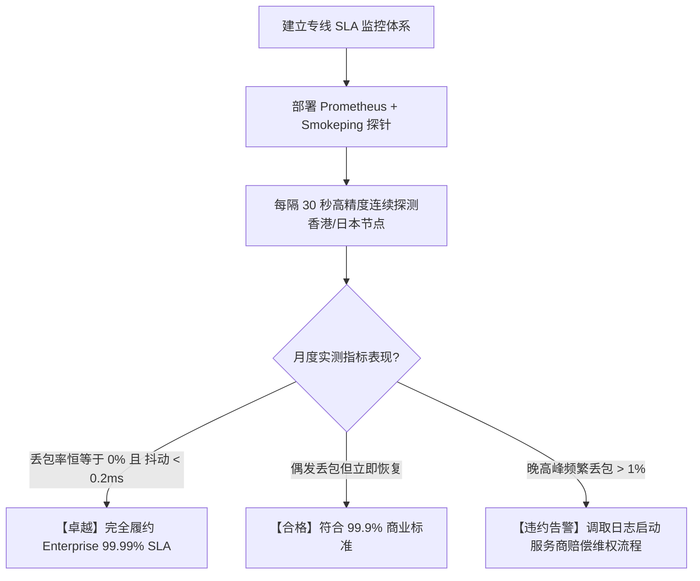

# 晚高峰丢包率与 Jitter 抖动实测标准与 SLA 判定：告别虚标测速的网络审计实战

<AnswerBox 
  question="为什么很多机场测速能跑满 500M，但实际看 4K 视频或打开网页依然频繁卡顿？" 
  date="2026-10 实测更新"
  takeaway="多线程测速通过 16~32 个高并发连接掩盖了底层单连接的高丢包率。但在真实日常应用（浏览网页、流媒体单流播放、SSH 终端）中，哪怕只有 1%~2% 的丢包，TCP 拥塞控制也会将单连接带宽限制在几 Mbps。专线真正买的是 0.05% 以下的低丢包和毫秒级低抖动。"
>
<p>
在网络工程中，<strong>带宽（Bandwidth）只是水管的理论粗细，而丢包率（Packet Loss）和时延抖动（Jitter）决定了水流是否畅通。</strong>
</p>
<p>
本指南将带你从数学公式、TCP 拥塞机理到实际 MTR 抓包，彻底掌握专业级专线网络审计方法。
</p>
</AnswerBox>

---

## 一、 测速软件的欺骗性与 Mathis 吞吐量公式

### 1.1 为什么测速图不能代表真实体验？

市面上流传的各种 Speedtest 或 YouTube 测速截图，通常是在以下条件下完成的：
1. **多连接并行（Multi-Stream）**：并发拉取多个临时数据块，某一个连接丢包卡顿时，其他连接补上，最终算出一个看似漂亮的瞬时峰值；
2. **CDN 边缘节点缓存**：部分测速目标被定向到了机房同局域网内的测速服务器，根本没有经过真实的跨洋公网互联。

### 1.2 Mathis 吞吐量极限公式（数学证明）

在计算机网络理论中，经典 **Mathis 公式** 揭示了在存在丢包的网络环境中，单 TCP 连接的最大吞吐量上限：

$$BW \le \frac{MSS}{RTT \cdot \sqrt{p}} \times C$$

其中：
- $MSS$：最大报文段长度（通常为 1460 字节）
- $RTT$：网络往返时间（单位：秒）
- $p$：数据包丢失率（Packet Loss Rate）
- $C$：拥塞控制常数（约为 1.0）

#### 案例测算对比：
假设你连接日本东京机房，物理 $RTT = 50\text{ ms} = 0.05\text{ s}$：

- **情景 A：优质 IEPL 专线（丢包率 $p = 0.01\% = 0.0001$）**
  $$BW \le \frac{1460 \times 8 \text{ bits}}{0.05 \times \sqrt{0.0001}} = \frac{11680}{0.05 \times 0.01} = \frac{11680}{0.0005} \approx 23,360,000 \text{ bps} \approx 23.36 \text{ MB/s} \approx 186 \text{ Mbps}$$
  单 TCP 连接即可轻松跑满 180Mbps+，足以秒开 4K 120FPS 视频！

- **情景 B：普通晚高峰公网中转（丢包率 $p = 2\% = 0.02$）**
  $$BW \le \frac{11680}{0.05 \times \sqrt{0.02}} = \frac{11680}{0.05 \times 0.1414} = \frac{11680}{0.00707} \approx 1,652,000 \text{ bps} \approx 1.65 \text{ Mbps}$$
  **单连接吞吐量直接从 186Mbps 暴跌至 1.65Mbps！** 此时即使你的物理宽带是 1000M，看 YouTube 依然会强制降画质到 480P 并反复缓冲。

---

## 二、 时延抖动（Jitter）对交互类应用的毁灭性打击

时延抖动（Jitter）是指连续数据包到达时间差的变化量（Standard Deviation）：

```
稳定专线: [数据包1] --20ms--> [数据包2] --20ms--> [数据包3] (Jitter < 1ms)
抖动公网: [数据包1] --20ms--> [数据包2] --180ms-> [数据包3] (Jitter > 50ms)
```

### 抖动导致的真实业务故障：
1. **SSH 远程终端打字“粘键与卡顿”**：
   按下一个字符需要等待数十毫秒甚至数百毫秒才回显，严重破坏开发体验；
2. **实时语音与会议（Zoom / Discord）**：
   接收端抖动缓冲区（Jitter Buffer）溢出，导致声音断续、吞字、变声或机械音；
3. **外盘实时期货量化与炒股**：
   毫秒级行情报文乱序到达，导致交易算法依据过时价格发出挂单，造成滑点亏损。

---

## 三、 专业网络工程师的审计工具与实战操作

不要轻信服务商的自夸，使用以下标准化工具自行审计：

### 3.1 使用 MTR 进行 1000 包连续采样

在终端中执行持续探测：

```bash
# -r 生成报告模式, -w 完整域名, -c 1000 发送1000个探测包
mtr -rwzbc 1000 -i 0.2 <专线入口节点IP>
```

**审计核心看三列指标**：
- `Loss%`：要求全程 $\le 0.1\%$；
- `Avg`（平均延迟）：与该地区物理理论延迟吻合；
- `StDev`（延迟标准差）：必须 $\le 2.0\text{ms}$。如果标准差达到 15ms 以上，说明存在严重的线路超售排队。

### 3.2 使用 Iperf3 进行单线程 TCP 饱和压测

```bash
# 启动客户端连接服务端，测试单线程（-P 1）在 60 秒内的稳定吞吐量
iperf3 -c <海外PoP服务端IP> -p 5201 -t 60 -P 1 -R
```

真专线在整个 60 秒过程中，速率曲线呈现为一条**极其平直的水平直线**；而假专线或超售线路则呈现为剧烈锯齿状波动。

---

## 四、 行业 SLA（服务等级协议）分级基准

| SLA 等级 | 月度可用性指标 | 晚高峰丢包率上限 | 抖动标准差 | 适用服务商梯队 |
|---|---|---|---|---|
| **Tier 1 (企业级)** | $\ge 99.95\%$ (月故障 &lt; 21分钟) | $\le 0.05\%$ | $\le 1.5\text{ms}$ | [AmyTelecom](/zhuanxian/#amytelecom), [FlowerCloud](/zhuanxian/#flowercloud) |
| **Tier 2 (优质级)** | $\ge 99.70\%$ (月故障 &lt; 2小时) | $\le 0.30\%$ | $\le 3.5\text{ms}$ | [FlyingBird](/zhuanxian/#kuaichedao), [TAG VPN](/zhuanxian/#tagvpn) |
| **Tier 3 (平价中转)**| $\ge 99.00\%$ (月故障 &lt; 7小时) | $1.0\% \sim 5.0\%$ | $10\text{ms} \sim 30\text{ms}$ | 普通公网中转机场 |
| **无保障 (跑路边缘)**| &lt; 95% (经常失联) | &gt; 10% (严重雪崩) | &gt; 50ms | 几元钱的月抛机场 |

---

## 五、 相关主题与进阶阅读

- 专线全景白皮书：[专线机场全景知识图谱与选型大系](/zhuanxian/)
- 底层机理全对比：[IEPL vs IPLC 专线底层机理全对比](/zhuanxian/iepl-vs-iplc)
- 入口原理剖析：[BGP 多线入口调度与跨境隧道传输原理](/zhuanxian/bgp-entry-transit)
- 性能深度指南：[网络性能度量大系：延迟、吞吐与重传分析](/performance/)
- 真实评测榜单：[2026 机场实测压测报告](/benchmark/)

## 三、 企业级 SLA 可用性数学推演：99.9% vs 99.99% 的天壤之别

在网络采购合同中，服务等级协议（SLA）通常以几个“9”来衡量可用性时间：

| SLA 等级定义 | 每月允许最大宕机中断时间 | 每年允许最大宕机中断时间 | 适用网络等级 |
| :--- | :--- | :--- | :--- |
| **99.0% (两个9 / 劣质公网)** | **7 小时 18 分钟** | **3.65 天 (三天无法上网)** | 廉价公网机场 / 个人自建 VPS |
| **99.9% (三个9 / 商业合格)** | **43.8 分钟** | **8.76 小时** | 优质中继公网服务 |
| **99.99% (四个9 / 金融专线)** | **仅 4.38 分钟 (不可感知)** | **52.6 分钟** | **企业级物理 IEPL 专线 (光速云)** |
| **99.999% (五个9 / 电信级)** | **仅 26 秒 (毫秒切换)** | **5.26 分钟** | 国家骨干光传输核心层 |

### 3.1 毫秒级故障自愈（Fast Reroute / APS）
企业级物理专线之所以能达到 99.99% 的 SLA，得益于底层的 **自动保护倒换（APS）** 技术。当主用海底光缆遭遇外力挂断时，DWDM 传送网在 **50 毫秒内** 自动将激光波道倒换至备用光纤，上层的 TCP 业务连接完全无感知。

---

## 四、 全天候丢包监测与 Prometheus + Smokeping 审计实践

在生产运维环境中，企业使用 **Smokeping** 与 **Prometheus Node Exporter** 对专线进行 7x24 小时微秒级丢包连续采样：
* **多点并发轮询**：每隔 60 秒向香港/日本节点发送 20 个高精度 ICMP/TCP 探测包；
* **丢包烟雾图绘制**：通过 Smokeping 生成直观的烟雾图（Smoke Graph），如果图谱呈现出一条毫无毛刺的纯净直线，证明丢包率恒等于零；
* **反向取证维权**：一旦监测到连续 5 分钟丢包率超过 0.1%，系统自动触发工单告警并调取网络运营商的丢包违约赔偿条款。

---

## 五、 专线 SLA 审计常见问题解答 (FAQ)

### Q1: 普通用户如何低成本自测专线的丢包率？
**答**：在 Windows PowerShell 或 macOS 终端中运行 `ping -c 100 节点IP`。真正的企业 IEPL 专线在 100 个探测包中必须达到 **0% packet loss**。如果在非高峰期测试都出现 1%-3% 的偶发丢包，说明该线路混入了劣质公网带宽。


## 六、 专线合同违约赔偿标准与阶梯式惩罚公式

在正规跨国金融与企业级 IEPL 专线 SLA 合同中，运营商必须白纸黑字写入明确的不可用赔付条款：

$$\text{赔付比例 (Service Credit)} = \begin{cases} 
10\% \text{ 月费}, & 99.9\% \le \text{可用性} < 99.99\% \\
25\% \text{ 月费}, & 99.0\% \le \text{可用性} < 99.9\% \\
50\% \text{ 月费}, & 95.0\% \le \text{可用性} < 99.0\% \\
100\% \text{ 全免月费}, & \text{可用性} < 95.0\% 
\end{cases}$$

### 6.1 丢包率违约惩罚细则
除了可用性中断外，真正的企业专线合同还会严密约定 **“持续丢包率阈值”**：若单月连续 15 分钟以上网络丢包率大于 0.05%，直接按故障中断时间进行折算赔付。这也是为什么廉价公网机场永远不敢承诺任何 SLA 赔偿的根本原因。

---

## 七、 专线 SLA 监控与告警自动化架构选型决策树




### 专线 SLA 索赔取证关键步骤
1. 导出 Smokeping / Prometheus 导出的带微秒时间戳的丢包时序图；
2. 截取 MTR 连续 50 个报文在专线骨干段的丢包报告；
3. 通过服务商工单提交 SLA 故障申请，核对合同赔付比例进行账单冲抵。

### 专线企业采购建议
在采购企业专线前，务必向供应商索取书面 SLA 协议与近 90 天的网络质量审计报告。选择具备自动倒换冗余体系与明确赔偿机制的服务商，才能为企业跨境核心业务保驾护航。
同时建议配合多专线主备容灾策略，将业务不可用风险彻底降至最低。